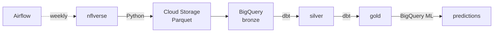
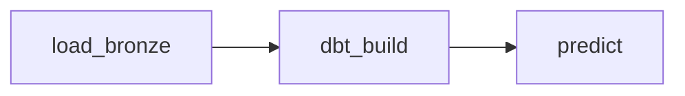

# NFL Touchdown Predictor

A weekly data pipeline that predicts each NFL player's chance of scoring a touchdown in the upcoming week, and explains the top reasons behind each prediction.

## What it does
Every Tuesday after Monday Night Football, the pipeline:
1. Downloads the latest play-by-play, schedules, rosters, injuries and depth charts from nflverse
2. Loads them into BigQuery (bronze layer)
3. Cleans and models them with dbt into silver and gold tables, with data tests
4. Scores next week's players with a BigQuery ML logistic regression model

## Architecture


## Weekly workflow (Airflow)
The pipeline runs as an Airflow DAG, `nfl_weekly`, every Tuesday at 9 AM, after Monday Night Football.



| Step | Task | What it does |
|---|---|---|
| 1 | `load_bronze` | Downloads the current season from nflverse, saves it to Cloud Storage, and loads it into BigQuery. Retries up to 2 times if the download fails |
| 2 | `dbt_build` | Rebuilds the silver and gold tables and runs the data tests (duplicates, nulls, row counts) |
| 3 | `predict` | Scores the upcoming week's players with the BigQuery ML model and saves the predictions with their top reasons |

Each step only starts if the one before it succeeds, so bad data never reaches the predictions.

- **Schedule:** `0 9 * * 2` (Tuesdays at 9 AM)
- **Runs in:** Docker, using the official Airflow `docker-compose.yaml`
- **Code:** `dags/nfl_weekly.py`

## Tools
| Area | Tool |
|---|---|
| Ingestion | Python, nflreadpy, Polars |
| Storage | Google Cloud Storage (data lake) |
| Warehouse | BigQuery (bronze / silver / gold) |
| Transformation & tests | dbt |
| Machine learning | BigQuery ML (logistic regression, explain_predict) |
| Orchestration | Apache Airflow in Docker |

## Model
- **Features:** last-4-game red-zone touches, touchdowns, red-zone run rate, TE target share, opponent TDs allowed, implied team points, injury status, head-to-head history
- **Training:** 2018–2024 seasons; tested on 2025
- **Result:** ROC AUC of [your number] on the 2025 test season
- Only uses data known before kickoff, so there's no leakage

## How to run it
1. Create a Google Cloud project, a storage bucket, and the datasets `nfl_bronze`, `nfl_silver`, `nfl_gold`
2. Create a service account key and save it as `key.json` in the project folder
3. `pip install -r requirements.txt`
4. `python ingestion/load_bronze.py`
5. `cd nfl` then `dbt build`
6. Train the model (SQL in [file name])
7. `python ingestion/predict.py`
8. Optional: run it weekly with Airflow (see `dags/nfl_weekly.py`)

## Project structure
```
[paste the output of: tree /f]
```

## Data credit
Data from [nflverse](https://github.com/nflverse), including charting data from FTN Data.

## Disclaimer
This is a personal learning project. It is not betting advice.